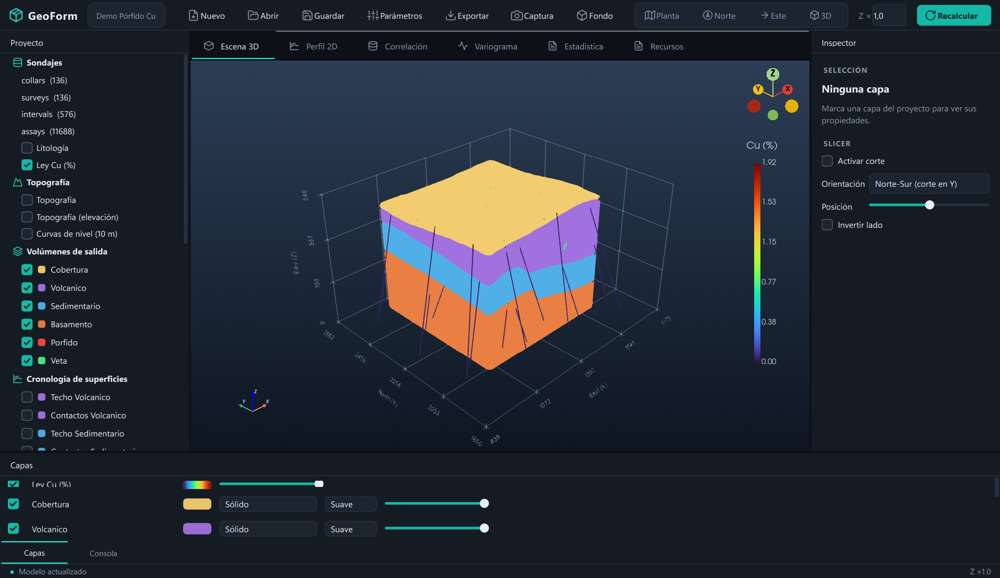
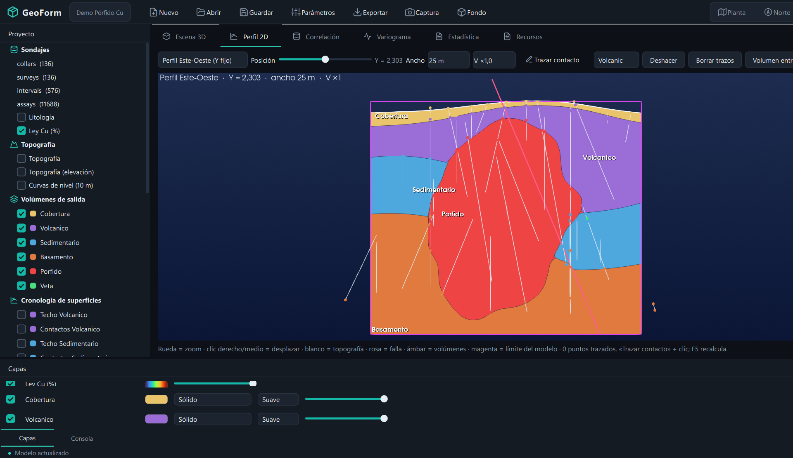
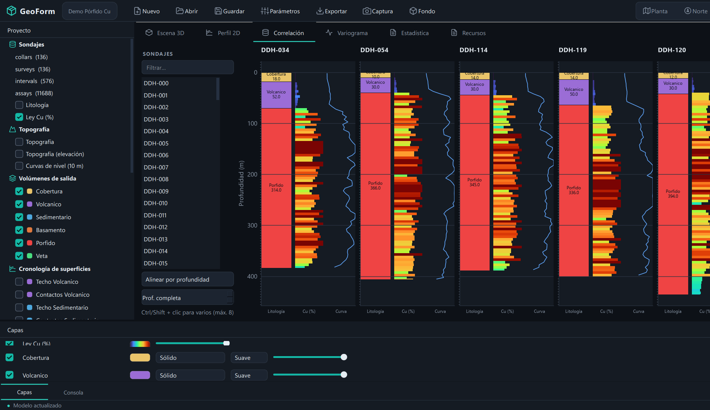
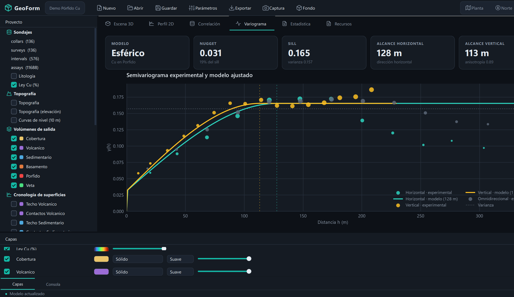
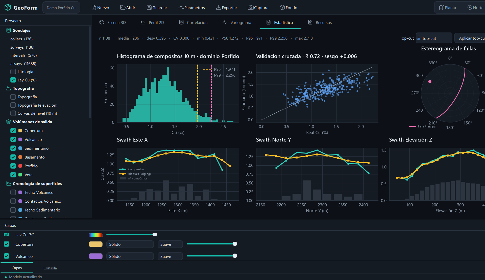
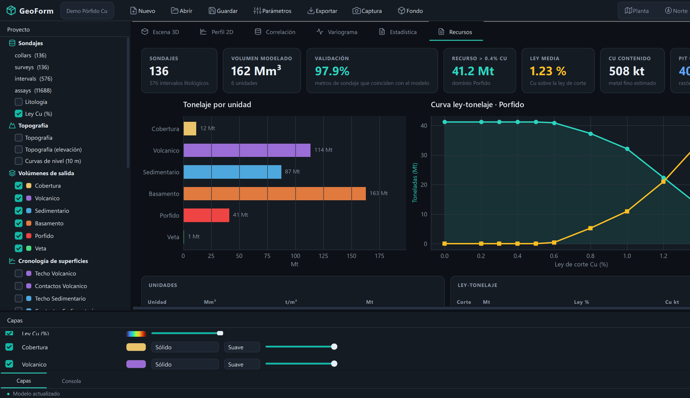
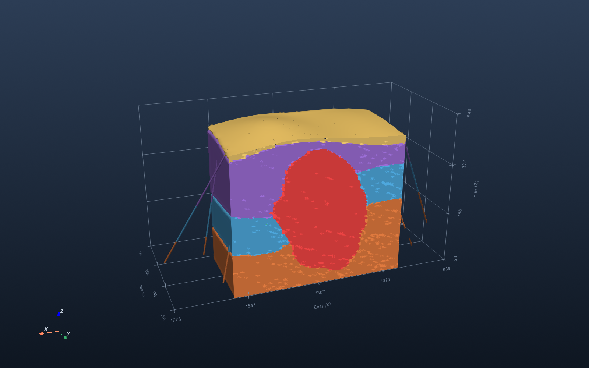
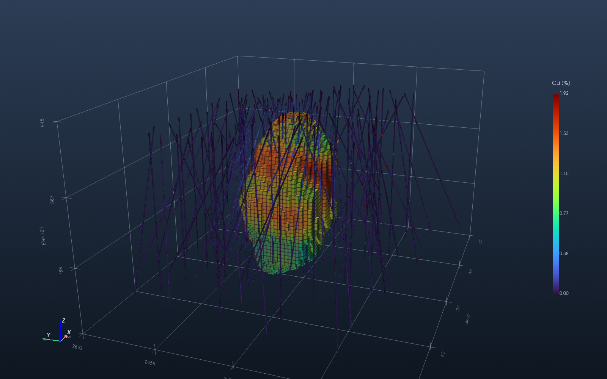
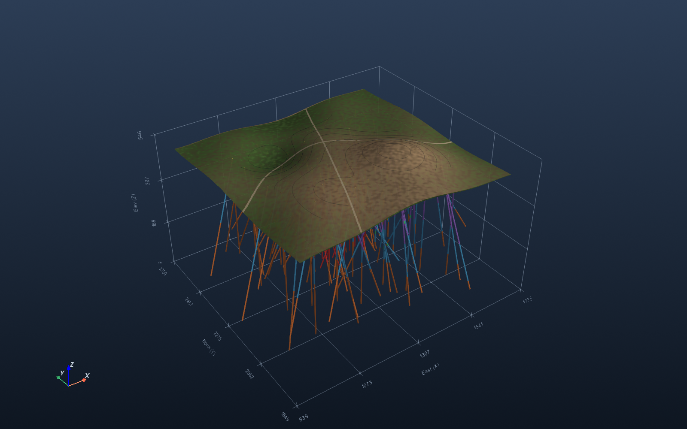
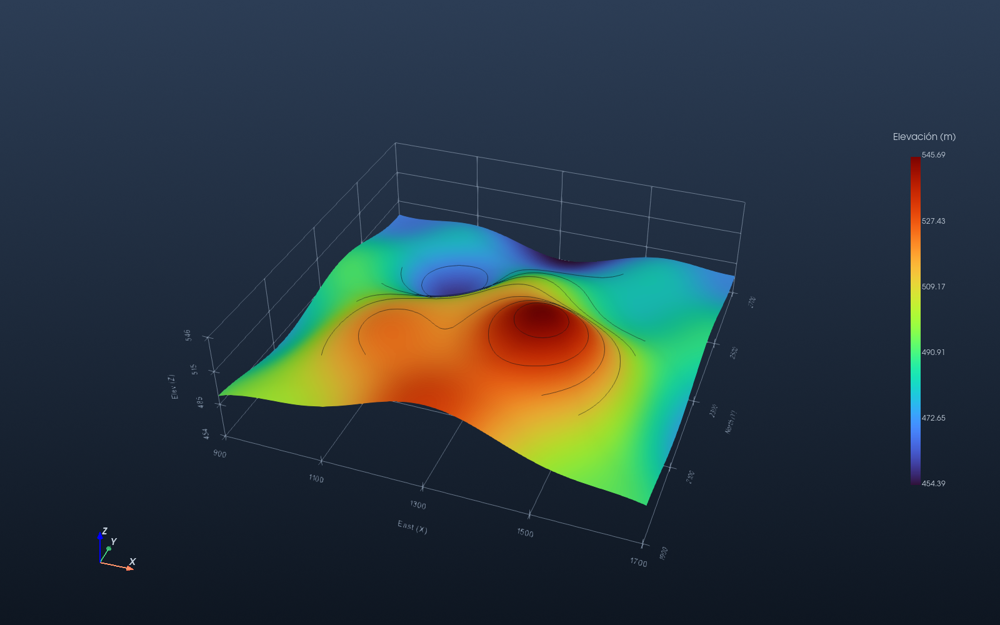

# GeoForm — modelador geológico 3D

Modelamiento geológico implícito, estructural y estimación de recursos a partir de sondajes.


## Capturas
| | |
|---|---|
|  **Escena 3D** · sólidos, sondajes por ley y capas con estilo de render |  **Perfil 2D** · corte ortogonal, trazado de contactos y exageración vertical |
|  **Correlación** · columnas litológicas y leyes de varios sondajes |  **Variograma** · experimental y modelo con anisotropía |
|  **Estadística** · histograma, validación cruzada, estereograma y swath plots |  **Recursos** · KPI, tonelaje por unidad, ley-tonelaje y pit óptimo |
|  **Corte** · falla con escalón y pórfido |  **Kriging** · block model restringido al dominio |
|  **Topografía** · ortofoto y curvas de nivel |  **Elevación** · DEM con exageración vertical |

## Qué hace
- **Datos**: collars, surveys, litología y leyes (CSV), DEM `.asc` y ortofoto. Los importadores
  validan columnas, números e intervalos e indican el archivo y la fila con error.
- **Modelo geológico implícito** ([geomodel.py](geoform/geomodel.py)):
  - estratigrafía con contactos 2.5D (TPS) y cobertura como espesor bajo la topografía;
  - **fallas**: bloques independientes, y el salto sale de los datos;
  - **intrusivos**: cuerpos cerrados (RBF 3D) que cortan la secuencia;
  - sólidos cerrados por unidad (marching cubes), recortados por la topografía.
- **Estimación** ([estimation.py](geoform/estimation.py)): compósitos por dominio, variogramas
  experimentales horizontal, vertical y omnidireccional, ajuste esférico con anisotropía, kriging
  ordinario en bloques restringido al sólido del dominio y curva ley-tonelaje.
- **Escena 3D** ([scene.py](geoform/scene.py)): sólidos, falla, sondajes por litología o ley, block
  model, topografía (satélite o elevación) con curvas de nivel, slicer con caras de corte coloreadas
  y exageración vertical.
- **Diseño** ([theme.py](geoform/theme.py)): tema oscuro, tipografía Inter/Segoe UI Variable, iconos
  SVG; la GUI, los gráficos y la escena 3D comparten la misma paleta.
- **GUI** ([gui.py](geoform/gui.py)):
  - árbol de proyecto, capas (visibilidad, color, opacidad), inspector y slicer;
  - pestañas *Variograma* y *Recursos*, con tarjetas KPI;
  - diálogos de proyecto nuevo y de parámetros (orden estratigráfico, intrusivos, fallas, dominio,
    resoluciones).
- **Proyecto** `.geoform` (JSON) con guardar y abrir ([project.py](geoform/project.py)).
- **Exportación** ([export.py](geoform/export.py)): sólidos y fallas a DXF (3DFACE) y OBJ, block
  model a CSV y reporte TXT.

## Instalación y uso
```bash
python -m venv .venv
.venv\Scripts\python -m pip install -e .[build]
.venv\Scripts\python -m geoform                     # GUI con el demo (pórfido Cu sintético)
.venv\Scripts\python -m geoform proyecto.geoform    # abrir un proyecto
.venv\Scripts\python -m geoform collars.csv surveys.csv intervals.csv --assays assays.csv --topo dem.asc
.venv\Scripts\python -m geoform --report            # volúmenes + ley-tonelaje en consola
.venv\Scripts\python -m geoform --screenshot out.png --section
.venv\Scripts\python docs\gallery.py                # regenera las capturas 3D de docs/img/
.venv\Scripts\python docs\gallery_gui.py            # regenera las capturas de la GUI (abre la ventana)
```
Convención de los CSV: la `z` del collar es la **elevación**, el `dip` es negativo hacia abajo y el
azimut se mide desde el norte.

## Datos demo
[synth.py](geoform/synth.py) genera en `geoform/data` un yacimiento con verdad conocida:
- topografía y ortofoto;
- 4 unidades plegadas;
- una falla normal (N30E/70SE, salto de 50 m);
- un pórfido mineralizado;
- 136 sondajes inclinados.

El modelo reproduce la litología con ~96 % de acierto. Para regenerar los datos:
`python -m geoform.synth`.

## Tests
Ver [docs/VERIFY.md](docs/VERIFY.md).
```bash
python -m tests.test_db_import
for m in desurvey implicit kriging model assemble block_model grade verify topography estimation export geomodel project; do python -m geoform.$m; done
python -m geoform --smoke-gui
```

## Empaquetado (.exe)
```bash
.venv\Scripts\python -m PyInstaller geoform.spec --noconfirm
```
El resultado queda en `dist/geoform/geoform.exe`. El `.spec` agrega los DLL de conda
(`C:/ProgramData/spyder-6/Library/bin`) cuando existen. **No construyas dentro de OneDrive**: el
sincronizador bloquea `dist/` y puede romper la carpeta.

## Contribuir
```bash
git clone https://github.com/clfranmunoz-bot/GeoForm.git
cd GeoForm
python -m venv .venv
.venv\Scripts\python -m pip install -e .[build]
```
Haz un fork, crea una rama, corre los tests de arriba y abre un pull request.
